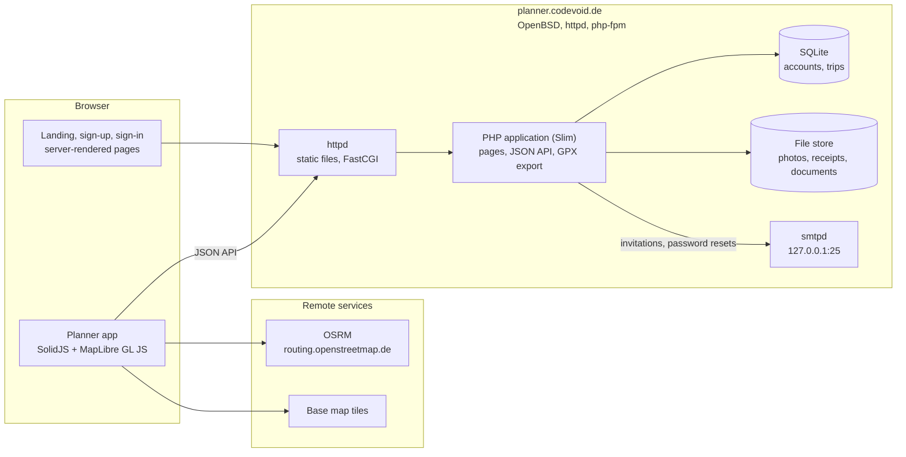
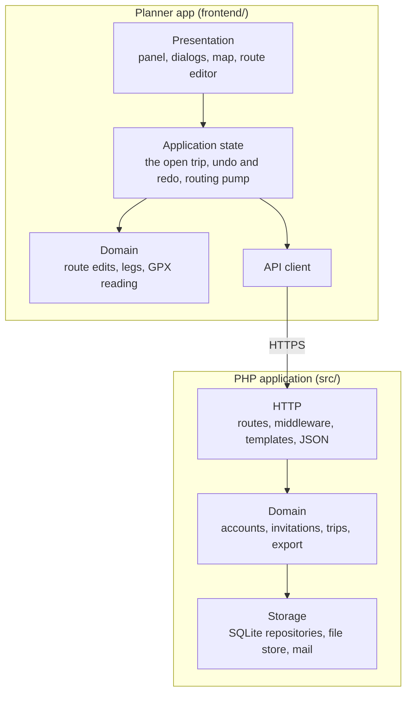
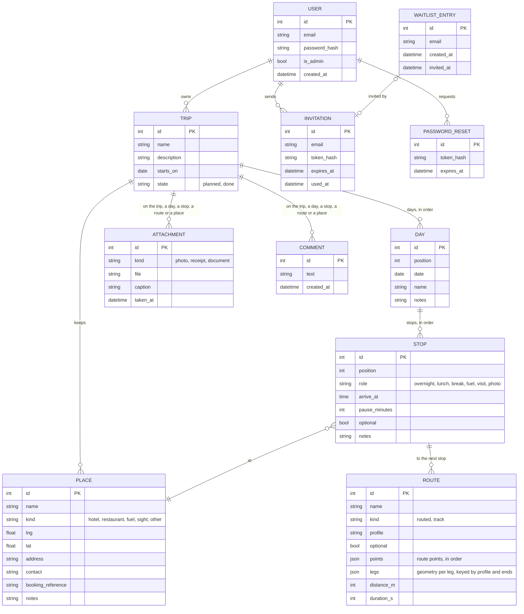

# Architecture

## High-level architecture

The server renders the public pages and serves the planner app, which talks to it over a
JSON API. Routing and map tiles are fetched by the browser directly.

## Block diagram

| Layer | Contents |
|---|---|
| Presentation (frontend) | The trip panel, the timeline, dialogs, the map view and the route editor's markers. |
| Application state (frontend) | The trip being edited, its undo and redo history, the pull-based routing pump, autosave. |
| Domain (frontend) | Pure route edits, leg keys and geometry, GPX reading; ported from Layer Slayer with their tests. |
| API client (frontend) | Requests to the JSON API; the one place that knows its URLs. |
| HTTP (backend) | Slim routes and middleware (sessions, CSRF, authentication), Plates templates for the public pages, JSON encoding of API answers. |
| Domain (backend) | Accounts, waiting list and invitations, trips with their parts, the timeline, GPX writing and export packaging. |
| Storage (backend) | PDO repositories over SQLite, the file store on disk, mail over SMTP. |

## Database

The target model. Phase 0 implements the account tables; the trip tables follow in
phases 1 to 4.

A route's points and legs are stored as JSON in the route's row, in the shape the route
editor works with. Attachments and comments carry one nullable foreign key per possible
target with a check that exactly one is set, so that deleting a target deletes them.
