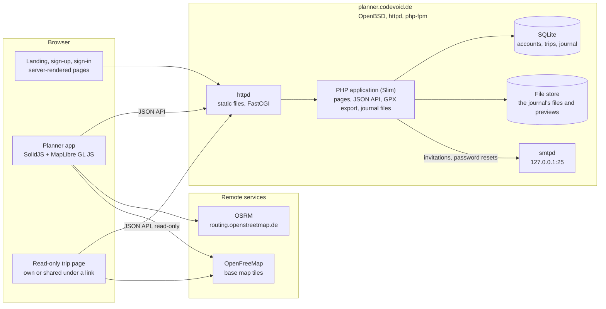
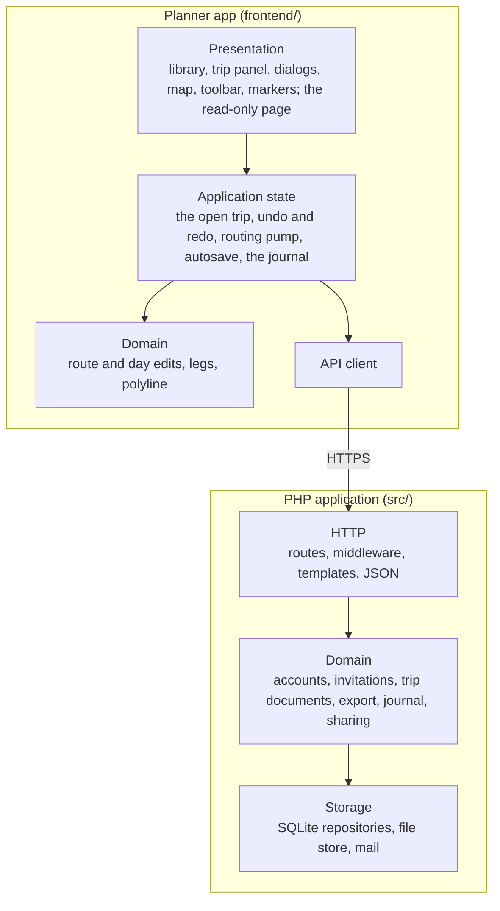
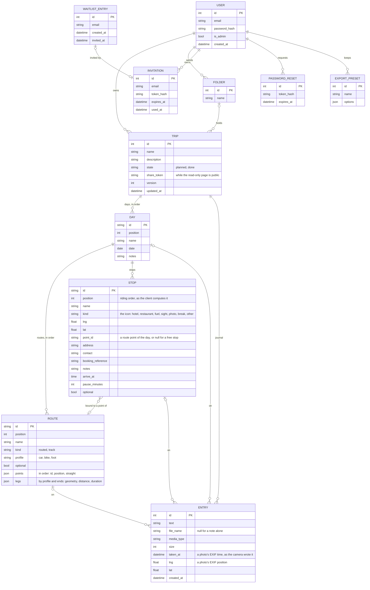

# Architecture

## High-level architecture

The server renders the public pages and serves the planner app, which talks to it over a
JSON API. Routing and map tiles are fetched by the browser directly.

## Block diagram

| Layer | Contents |
|---|---|
| Presentation (frontend) | The library (`library/`), the trip panel and its dialogs for a stop, the export, the journal and sharing (`trip/`), the map with its route lines, stop, point and photo markers, interactions, toolbar, hint bar and context menu (`map/`), small controls (`ui/`), and the read-only trip page with its own map (`view/`), a second entry (`view.tsx`). |
| Application state (frontend) | The open trip, the selected day and the route being edited, undo and redo and the actions that edit the trip (`state/trip.ts`), the pull-based routing pump (`state/routing.ts`), the autosave, which sends the stops in riding order (`state/autosave.ts`), the open trip's journal (`state/journal.ts`), the tool, the toggles, the open menu and dialogs (`state/drawing.ts`). |
| Domain (frontend) | Pure edits of a route and of a day's stops and routes, the riding sequence of a day with distances and riding times, the day's timeline, leg keys and geometry, the polyline codec, the OSRM client (`routing/`); reading GPX files into routes and stops (`gpx/`); distances, nearest-line search and line simplification (`geo/`); the document types (`model/`). |
| API client (frontend) | `api.ts`: requests to the JSON API, the one place that knows its URLs. |
| HTTP (backend) | Slim routes and middleware (sessions, CSRF, body parsing, authentication), Plates templates for the public pages and the two bundle pages, JSON encoding of API answers (`Http/`, `Pages/`, `Api/`). |
| Domain (backend) | Accounts and password resets (`Account/`), waiting list and invitations (`Signup/`), the library's trips and folders with their state and share token, trip documents with their validator and copies (`Trip/`), GPX writing with its options, the proximity of free stops and the export presets (`Export/`), the journal's entries, EXIF reading, files and previews (`Journal/`), the read-only API of a shared trip (`Share/`). |
| Storage (backend) | PDO repositories over SQLite, the file store on disk (`Journal/FileStore`), mail over SMTP (`Mail/`). |

## API

All under `/api`, for a signed-in user; answers are JSON unless a download or a file.

| Method and path | Does |
|---|---|
| `GET /me` | The user's e-mail address and admin flag. |
| `GET /trips` | The user's trips, last changed first, with their folder, state, day count and first dated day. |
| `POST /trips` | Creates a trip from `{name, folderId}`; the folder may be null. |
| `GET /trips/{id}` | The trip document: name, description, state, version, days (each with its date) with routes and stops in riding order. |
| `PUT /trips/{id}` | Replaces the trip's content with the document sent, which carries the version it was loaded at; 409 when that is no longer the current version, 422 when the document is malformed or names parts of another trip. |
| `POST /trips/{id}/copies` | A copy of the trip with all its days under new ids, named after it, in its folder; answers the copy's id. |
| `PATCH /trips/{id}` | Puts the trip into the folder of `{folderId}`, or into none for null. |
| `DELETE /trips/{id}` | Deletes the trip with everything in it. |
| `GET /trips/{id}/gpx` | The trip as GPX with the options `per=trip|day` (one file, or a zip with one per day), `form=tracks|routes`, `optional=0|1`, `reachM=<metres>`; `?day=<id>` one day alone. |
| `GET /trips/{id}/share` | `{token}`: the token the trip's read-only page is public under, or null. |
| `POST /trips/{id}/share` | Makes the page public under the trip's token, a new one where it has none; answers `{token}`. |
| `DELETE /trips/{id}/share` | Takes the page off the public. |
| `GET /trips/{id}/entries` | The trip's journal entries, oldest first: text, file (name, media type, size, whether an image), the part it is on, when and where a photo was taken. |
| `POST /trips/{id}/entries` | Adds an entry from a multipart form: `text`, one of `dayId`, `stopId`, `routeId` (none for the trip), `file`. A photo's EXIF time and position are read; one with a time and no part goes to the day of that date. |
| `PATCH /trips/{id}/entries/{entry}` | Replaces the entry's text from `{text}`. |
| `DELETE /trips/{id}/entries/{entry}` | Deletes the entry with its file. |
| `GET /trips/{id}/entries/{entry}/file` | The file as uploaded, shown in the browser where it can be, offered for download otherwise. |
| `GET /trips/{id}/entries/{entry}/preview` | A small JPEG of an image entry. |
| `GET /export-presets` | The user's export presets by name. |
| `POST /export-presets` | Keeps `{name, options}` as a preset, replacing one of that name. |
| `DELETE /export-presets/{id}` | Deletes the preset. |
| `GET /folders` | The user's folders by name. |
| `POST /folders` | Creates a folder from `{name}`. |
| `PATCH /folders/{id}` | Renames the folder from `{name}`. |
| `DELETE /folders/{id}` | Deletes the folder; its trips stay, in no folder. |

A trip shared under a token is readable without sign-in under `/api/shared/{token}`:
the document, `/entries`, `/entries/{entry}/file` and `/entries/{entry}/preview`, as above.

The read-only page is served at `/trips/{id}` for the owner and at `/t/{token}` for
everyone; the page names the API it reads from.

## Database

The schema is `db/schema.sql`.

A trip's parts carry ids the client generates, so that the trip's content is saved as
one document: rows are upserted by id and the ones the document no longer holds are
deleted. A route's points and legs are stored as JSON in the route's row, in the shape
the editor works with; each routed leg holds its polyline6 geometry, length and riding
time as OSRM answered. A bound stop's position equals its route point's, which the
validator checks. A journal entry belongs to its trip and names at most one of a day, a
stop or a route by a nullable foreign key, which the schema checks; when that part goes,
the key is set to null and the entry stays with the trip. An entry's file lies in the
file store under `files/{trip}/{entry}`, its preview beside it.
