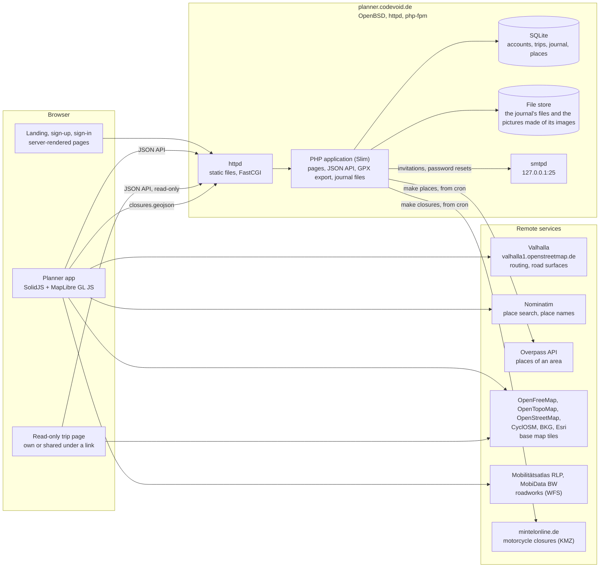
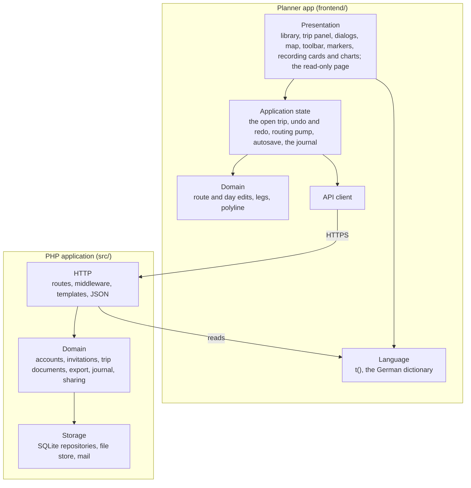
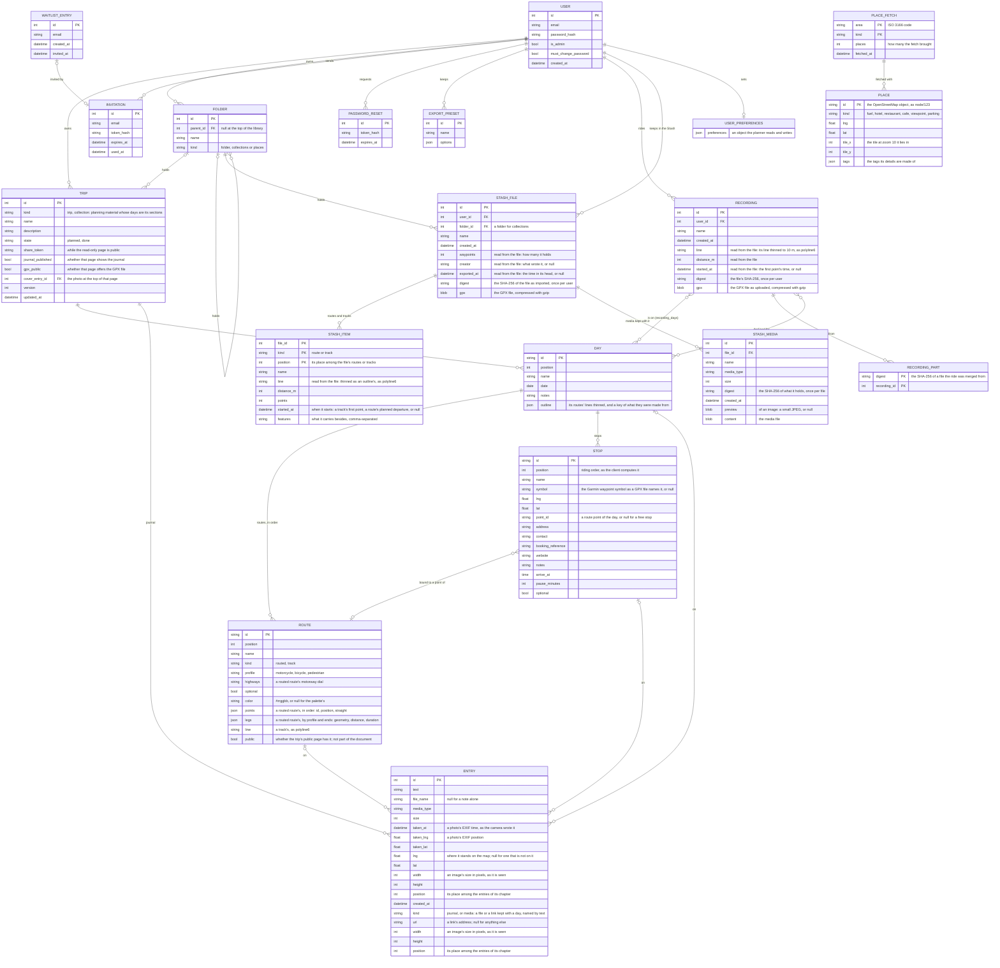

# Architecture

## High-level architecture

The server renders the public pages and serves the planner app, which talks to it over a
JSON API. Routing and map tiles are fetched by the browser directly.

## Block diagram

| Layer | Contents |
|---|---|
| Presentation (frontend) | The library's pane (its actions, search, its tabs for the Stash, the trips, the lists of places, the rides and the settings, and the open trip's actions in its row's menu), a tree of folders for each of the first three, with trips or, in the Stash, files that unfold to their routes and tracks (`library/StashFileCard.tsx`), and their dragging onto folders, the duplicates report in the pane beside the library, the rides by when they were ridden, which the fourth lists and which also takes GPX files as rides, names rides after where they began and ended, merges them and lists the days suggested for them, the import of what is dropped on a folder or picked from its menu, the import of exported trips, the library's tree with its cards, the Stash's menus, its rows' keys and its search beside it (`library/`), the pane of the open trip's days and the pane of what a day holds, the open list's categories in the tree and the pane of the one whose pad was pressed, the days in the strip of the trip's folded pane and their dialogs for the trip, a day, a route and a stop, the export, the journal and sharing (`trip/`), the settings under the library's gear tab (`settings/`), the map with its base maps, its overlays (the roadworks, the motorcycle closures, all the user's rides, the sizes and signs they draw with) and their controls, the place search, the places of the store and the user's own, route lines and the naming of the one under the pointer, the lines the map draws kept for what measures across them and the dashed line with the distance to the nearest of them, the kinds of places with their marks, switches and settings, stop, point and photo markers, interactions, toolbar and the routing's state, the opened recording's cards of figures and charts and the details of a point picked on it (`map/`), small controls, the chart, the dialog shell, the list that keeps its rows by id, the shell every pane beside the map has, with its head, its pads that fold and close it, its strip and its sheet handle, the one selection and how a row takes part in it, the pad, the grip and the pin of a row, what is carried from a pad to the places that take a drop, the one menu and the button that opens a row's, the keys of the file verbs, the long press and the pointer drags shared by the map and the panel, the lightbox, which steps through a gallery, Markdown as HTML, the theme, the colour tokens and the browser's preferences (`ui/`), and the trip's page (`view/`), a second entry (`view.tsx`): the plan as a head, a map and the days, or the story as the journal's chapters and galleries beside a map that follows what is read (`view/follow.ts`). |
| Application state (frontend) | What the map shows of the Stash, a file read when it is picked (`state/stash.ts`), the open trip as an immutable value, the selected day, the day whose contents have their pane, the route being edited, the trip looked at on the map without being open, where the tree's mark is, undo and redo and the actions that edit the trip (`state/trip.ts`), the pull-based routing pump (`state/routing.ts`), the autosave, which sends the stops in riding order (`state/autosave.ts`), the open trip's journal, read as chapters, with what shows it (`state/journal.ts`), the files on their way into it (`state/uploads.ts`), what the open trip's public page shows (`state/publication.ts`), the word to the read-only pages of this browser that something changed (`state/changes.ts`), the files and links kept with its days (`state/media.ts`), the rides on the open trip's days and the rides opened or pinned in their tab, the one opened, their tracks once read and the days of riding a day's lookup found (`state/recordings.ts`), the routes and recordings pinned to the map, each with its trip and a copy of its line for while that trip is not open, and the rides pinned in their tab (`state/pins.ts`, `state/pinnedLines.ts`), what Trips and Places had open when they were left, opened again when they are shown again (`state/tabs.ts`), the recording opened for its figures with its line's colouring, what it is compared with, the point picked on it and the surfaces under it once matched (`state/recordingView.ts`), the section looked up among the rides, its end being marked, the rides that rode it and a track's part on it (`state/section.ts`), what was copied or cut to be pasted into a day, a category, a route, a trip, a list, a folder or among the recordings, and what a drag carries to be dropped there (`state/clipboard.ts`), the days, routes or stops selected to be acted on together (`state/partSelection.ts`), the places on the map: each kind's state (all, along the day's routes, none), whether all are hidden for now, the tiles read and the filter along the day's routes (`state/places.ts`), the user's own places on the map by their kinds' states (`state/ownPlaces.ts`), the account's preferences (`state/preferences.ts`), the library's trips and folders, the tab shown and the one the map follows, the trip being opened and how far that has come, the search (`state/library.ts`), whether the duplicates report stands in the open trip's pane's place (`state/pane.ts`), the duplicates report as last made and the lines of the routes selected in it (`state/duplicates.ts`), every ride, the lines of those held against a day they are suggested for, and how what is done to the rides goes and that they changed (`state/rides.ts`), the tool, the toggles, which routes are unfolded, the open menu and dialogs (`state/drawing.ts`), which panes are folded, which one is shown where one alone fits, and how much of a phone's screen the sheet takes (`state/panel.ts`). The colour of each route of the open trip (`state/routeColors.ts`). |
| Domain (frontend) | Pure edits of a route and of a day's stops and routes, the riding sequence of a day with distances and riding times, the day's timeline, leg keys and geometry, the polyline codec, the Valhalla client for routing and for the surfaces under a track (`routing/`); the palette of route colours and how routes without one of their own get theirs and the colours of stops (`model/routeLook.ts`); reading GPX, KML and KMZ files into routes and stops, writing what a KML or KMZ file holds as GPX for the Stash to keep, with the zip reader a KMZ and an exported trip are opened with (`gpx/`); reading and writing a recording's track with what it measured per point, its measures, summary and spreads, the rides grouped into days, months and years of riding, its comparison with another line by place, the part of a line on a section ridden in the same direction, the colours of its line and the surfaces under it (`recording/`); the kinds of places, the tiles they are asked for by, the filter along lines, what a place's tags say and the kinds of the user's own places (`poi/`); our icons, each standing for one Garmin symbol, and Garmin's symbols by theme (`symbols/`); distances, nearest-line search and line simplification (`geo/`); the document types, the library's tabs and what each tree is (`model/library.ts`), what folders hold and where things can be moved (`model/folders.ts`), what each kind of place takes of each kind of clipboard (`model/paste.ts`), what of a document a save leaves out as unchanged, and what a day's media are called and how each opens (`model/`). |
| API client (frontend) | `api.ts`: requests to the JSON API, the one place that knows its URLs; every request names the page's language. |
| Language (both) | `frontend/i18n/`: the page's language, from the browser or the kept choice, `t()` with plurals, and the German dictionary `de.json` by English text, which the server's `t()` reads too (`src/I18n/`); a middleware sets the request's language from a `lang` query parameter or `Accept-Language`, `Json::error` translates the API's messages, the templates their texts. |
| HTTP (backend) | Slim routes and middleware (sessions, CSRF, body parsing, authentication, the request's language, gzip for JSON answers, which then carry their unpacked length as `X-Uncompressed-Length`), Plates templates for the public pages and the two bundle pages, JSON encoding of API answers (`Http/`, `Pages/`, `Api/`). |
| Domain (backend) | The Stash's files and what is read from them to list them (`Stash/`), accounts and password resets (`Account/`), waiting list and invitations (`Signup/`), the library's trips and folders with their state and share token, what a trip's public page shows and what a visitor gets of it (`Share/`), trip documents with their validator and copies, the outline kept with each day (`Trip/`), GPX writing with its options, the proximity of free stops, the export presets and the zip of whole trips (`Export/`), the journal's entries, EXIF reading, files and previews (`Journal/`), the files and links kept with the days, which are entries of a kind of their own (`Media/`), the user's rides and the days they are on, what is read from a ride's file to be kept beside it, and the lookup of the days of riding that may be a day's (`Recording/`), the places of the map: the kinds, the question to the Overpass API and its answer, the fetch of an area and the store by tile, and the places of the user's own lists (`Poi/`), the account's preferences (`Account/`), the read-only API of a shared trip (`Share/`), fetching Garmin's symbol pictures for `make garmin-icons` (`Symbols/`), fetching the motorcycle closures and converting their KML to GeoJSON for `make closures` (`Closures/`). |
| Storage (backend) | PDO repositories over SQLite, the file store on disk (`Journal/FileStore`), mail over SMTP (`Mail/`). |

## API

All under `/api`, for a signed-in user; answers are JSON unless a download or a file.

| Method and path | Does |
|---|---|
| `GET /me` | The user's e-mail address and admin flag. |
| `GET /preferences` | What the user set for the planner as a whole: an object the planner owns, empty until set. |
| `PUT /preferences` | Replaces the preferences with the object sent. |
| `PUT /password` | Sets a new password, `{current, password, repeat}`, once `current` is the password in use. |
| `GET /places/own` | The places the user keeps in the lists of the Places folder, by list, kind and name: id, name, symbol, position, address, contact, website, notes, and the list (`tripId`, `list`) and kind (`dayId`, `kind`) each is in. |
| `GET /places/{x}/{y}` | The places in a tile of the web's maps at zoom 10 whose kind is among `kinds=` (comma-separated): id, kind, position and tags. Cacheable for a day. |
| `GET /trips` | The user's trips and collections by name, with their kind, folder, state, day count and first dated day. |
| `POST /trips` | Creates a trip from `{name, folderId, kind}`; the folder may be null, the kind is `trip` (the default) or `collection`. A collection goes into a special folder or a folder in one, a trip anywhere else; 422 otherwise. |
| `GET /trips/{id}` | The trip document: kind, name, description, state, version, days (each with its date) with routes and stops in riding order. |
| `PUT /trips/{id}` | Replaces the trip's content with the document sent, which carries the version it was loaded at. A day, or a route of a day sent whole, may be sent as `{id, unchanged: true}` and then stands for the stored one. 409 when the version is no longer the current one, 422 when the document is malformed, names parts of another trip or leaves out as unchanged what the trip does not hold. |
| `POST /trips/{id}/copies` | A copy of the trip with all its days under new ids, named after it, in its folder; answers the copy's id. |
| `POST /trips/{id}/merge` | Merges the trips `{tripIds}` of the same kind into the trip and deletes them: a day joins the trip's day of its date or goes in among its days by date, an undated day or a section goes at the end; parts, journal entries and files keep their ids. Answers `{version}`. |
| `PATCH /trips/{id}` | Renames the trip to `{name}`, counted as a change to it; or puts it into the folder of `{folderId}`, or into none for null; 422 for a folder that does not hold its kind. |
| `DELETE /trips/{id}` | Deletes the trip with everything in it; the rides on its days stay rides. |
| `GET /trips/{id}/gpx` | The trip as GPX with the options `per=trip|day` (one file, or a zip with one per day), `form=tracks|routes`, `optional=0|1`, `reachM=<metres>`. `days=<ids>` takes those days alone and `routes=<ids>` those routes alone, ids separated by commas; what then lies in one day is that day's file. 404 when none of them is in the trip. |
| `GET /trips/archive` | The trips named by `ids=` (comma-separated) as a zip to keep or to import again: a folder per trip with `trip.json` (document, journal, recordings), the journal's files, the recordings as GPX and a GPX file per day. Trips of another user are left out; 404 when none is left. |
| `GET /trips/outlines` | The outlines of the user's trips by trip id: its days in order, each with its id, name and date, how many routes, stops and recordings it holds, its routes that have a name (`namedRoutes`: id, name, kind), its length in metres (`distanceM`) and the lines of its routes, thinned to a few points each, as polyline6 with the colour a route has of its own. |
| `POST /trips/{id}/share` | Makes the page public under the trip's token, a new one where it has none; answers `{token}`. |
| `DELETE /trips/{id}/share` | Takes the page off the public. |
| `GET /trips/{id}/publication` | What the public page shows besides the plan: `{token, journal, gpx, coverEntryId, hiddenRouteIds}`, the token the page is public under or null, whether the journal is on it, whether it offers GPX files, the journal entry whose photo stands at its top, and the routes and tracks it leaves out. |
| `PUT /trips/{id}/publication` | Sets `{journal, gpx, coverEntryId, hiddenRouteIds}`; the cover is an image of the trip's journal, or null. |
| `GET /trips/{id}/public` | The trip's document as the shared API gives it, for the owner to look at, whether the trip is shared or not. |
| `GET /trips/{id}/entries` | The trip's journal entries by their `position`, which orders them within a chapter (the trip's own entries, or a day's with those on its routes and stops): text, file (name, media type, size, whether an image, an image's width and height), the part it is on, when and where a photo was taken (`takenLngLat`) and where the entry stands on the map (`lngLat`). |
| `POST /trips/{id}/entries` | Adds an entry from a multipart form: `text`, one of `dayId`, `stopId`, `routeId` (none for the trip), `file`, `lng` and `lat` for a spot on the map. It stands after every entry the trip has. An import hands on `createdAt`, the time the entry was written. A photo's EXIF time and position and an image's size are read; with `byDate` a photo with a time and no part goes to the day of that date. |
| `PATCH /trips/{id}/entries/{entry}` | Changes what the body names: `text`; `link`, an object with one of `dayId`, `stopId`, `routeId`, or an empty one for the trip itself; `lngLat`, where the entry stands on the map, or null to take it off the map. An entry linked into another chapter goes to its end. |
| `PUT /trips/{id}/entries/order` | Puts the entries `{ids}` in that order in the chapter of the day `{dayId}`, or of the trip itself for null. An entry of another chapter joins this one: it is linked to the day, or to the trip. |
| `DELETE /trips/{id}/entries/{entry}` | Deletes the entry with its file. |
| `GET /trips/{id}/entries/{entry}/file` | The file as uploaded, shown in the browser where it can be, offered for download otherwise. |
| `GET /trips/{id}/entries/{entry}/image/{px}` | An image entry's picture as a JPEG of at most `px` on its longer side, 400, 1280 or 2048, never larger than the image is. |
| `GET /trips/{id}/media` | The files and links kept with the trip's days, oldest first: entries of the kind `media`, each with its day, its name (`text`), and its file or its `url`. |
| `POST /trips/{id}/media` | Keeps a file or a link with a day, from a multipart form: `dayId`, a `name`, and a `file` or a `url` (http or https). 422 for neither or both, 404 for a day that is not the trip's. |
| `PATCH /trips/{id}/media/{entry}` | Moves it to the day `{dayId}`, of this trip or another of the user's, its file with it; or names it anew from `{name}`, a link with its `{url}`. |
| `POST /trips/{id}/media/{entry}/copies` | A copy of it, with its file, on the day `{dayId}`, of this trip or another of the user's. |
| `DELETE /trips/{id}/media/{entry}` | Deletes it with its file. |
| `GET /trips/{id}/media/{entry}/file` | The file as uploaded, as the journal's is served. |
| `GET /trips/{id}/media/{entry}/preview` | A small JPEG of an image. |
| `GET /rides` | Every ride of the user's, by when it began: its `id`, `name`, `startedAt`, `distanceM`, its `line` as polyline6 and the `days` it is on, each with its `tripId`, `dayId` and the name of its `trip`. What the rides' pane lists. |
| `GET /rides/lines` | The rides that have a line as GeoJSON: a line each with its `name`, `startedAt`, `distanceM` and the trips or collections it is on days of (`trip`). What the overlay of all rides reads. |
| `POST /rides` | Keeps a ride from a multipart form: `name`, `file`, a GPX file compressed with gzip, and with `dayId` the day it is put on. 201 with the ride; a file the user keeps already is not kept again and answers 200 with the ride it is kept as. |
| `GET /rides/joints` | Where a merge would join the rides `ids=` (comma-separated), in the order they began: for each ride after the first when it began (`startedAt`), the seconds since the one before it ended (`pauseS`, null where a file tells no times) and the metres from that one's end to its beginning (`distanceM`). |
| `GET /rides/suggestions` | The days of the user's trips that rides on no day may be of, as the lookup finds them for each day, without what was declined: `suggestions`, each with its `tripId`, `dayId`, the `date` of the riding, `sameDate`, `share` and `rideIds`. `offset=` is the minutes the user's clock is ahead of UTC. An answer looks through the days from the `from=`th on for a few seconds and says how many are `done` `of` all; the next request takes up from there. |
| `POST /rides/merge` | Merges the rides `{ids}`, which follow one another, into one: their files joined as the segments of one track, on every day one of them was on, named as the first. The rides merged are deleted and their files stay known as kept. 201 with the merged ride as `GET /rides` gives it; 422 where they do not follow one another, one has no times, or their files cannot be joined. |
| `PATCH /rides/{recording}` | Renames the ride from `{name}`. |
| `DELETE /rides/{recording}` | Deletes the ride with its file, from every day it is on. |
| `GET /rides/{recording}/gpx` | The ride's GPX file, sent compressed (`Content-Encoding: gzip`). |
| `PUT /rides/{recording}/days/{day}` | Puts the ride on a day of the user's. |
| `DELETE /rides/{recording}/days/{day}` | Takes the ride off the day; it stays a ride. |
| `PUT /rides/{recording}/days/{day}/declined` | Remembers that the ride is not of the day, for which it is then not suggested again; putting it on the day forgets that. |
| `GET /trips/{id}/recordings` | The rides on the trip's days, once for each day a ride is on, by when they began: id, day, name, length in metres (`distanceM`) and the time of the first point (`startedAt`, null where the file has no times). |
| `GET /trips/{id}/recordings/lookup` | The days of riding, among all the user's rides, that may be those of the day `day=`: begun on its date by the user's clock (`offset=`, the minutes it is ahead of UTC) or ridden along its routes, or its routes along them. Each with its `date` (null for a ride without times), `sameDate`, `share` and those of its `rides` that are not on the day yet, as `GET /rides` gives them; those of the date first, then the nearest. |
| `GET /export-presets` | The user's export presets by name. |
| `POST /export-presets` | Keeps `{name, options}` as a preset, replacing one of that name. |
| `DELETE /export-presets/{id}` | Deletes the preset. |
| `GET /duplicates` | The routes the user's library keeps more than once, in groups of exact copies or of the same ride, each route with its trip, day, name, kind (`routeKind`: `routed` or `track`) and length; a day's planned route with the tracks recorded of it is no group. |
| `GET /duplicates/lines` | The lines of the user's routes named by `routes=` (comma-separated ids), as polyline6 by the route's id, for the report to draw the routes selected in it. |
| `GET /stash` | The files of the user's Stash by name: `id`, `folderId`, `name`, `createdAt`, how many `waypoints` the file holds, its `creator` and `exportedAt` as its head has them, the `media` kept with it (each its `id`, `name`, `mediaType`, `size` and whether it is an `image` with a preview), and its routes and tracks as `items`, each with its `kind`, its `position` among the file's routes or tracks, `name`, `line` (thinned, polyline6), `distanceM`, `points`, `startedAt` where the file says when it starts (a track's first point, a route's planned departure), and `features`, what it carries besides: `time`, `elevation`, `lean` and `acceleration` on its points, `routeExtension` and `routePointExtension` of Garmin on a route, `dmd` and `rumo` for an extension of theirs. |
| `POST /stash/files` | Keeps a file from a multipart form: `name`, `folderId`, a folder of the Stash, and `file`, a GPX file compressed with gzip. Answers 201 with the file as it is listed, or 200 with the one kept already where the user keeps the same file anywhere in the Stash. |
| `PATCH /stash/files/{id}` | Renames the file with `{name}`, or moves it into another folder of the Stash with `{folderId}`. |
| `DELETE /stash/files/{id}` | Deletes the file. |
| `GET /stash/files/{id}/gpx` | The file as it is kept, compressed with gzip, as a download under its name. |
| `PATCH /stash/files/{id}/items/{kind}/{position}` | Renames the file's route or track at that place among its routes or tracks (`kind`: `route` or `track`) with `{name}`, which rewrites the file. |
| `DELETE /stash/files/{id}/items?items=` | Removes routes and tracks from the file, named comma-separated as kind and place (`track:0,route:2`), which rewrites the file. |
| `POST /stash/files/{id}/parts` | Adds parts of the user's other files to the file, which rewrites it and leaves the others as they are: `{parts}`, each with its `fileId`, its `items` as `{kind, position}` among that file's routes or tracks, and whether all its `waypoints` come along. Answers 204, or 404 where a file or one of the items is missing. |
| `POST /stash/files/{id}/rides` | Keeps the file's tracks as rides, all of them or with `{tracks}` those at these places among its tracks, each named after itself or else its file. Answers `{rides}`, the ride of each track with its `name`, when it `startedAt` (null without times) and whether it was `added`; where the user kept it already, the name and time are those of the ride kept. |
| `POST /stash/files/{id}/media` | Keeps a media file with the file, from a multipart form with the `file`. Answers the media file as it is listed, with 201, or with 200 the one the file has already. |
| `DELETE /stash/files/{id}/media` | Removes all the media of the file. |
| `GET /stash/files/{id}/media/{media}/file`, `…/preview` | The media file as it was kept, shown in the browser where it can be and offered for download otherwise; of an image a small JPEG. |
| `GET /folders` | The user's folders, each with the folder it is in (`parentId`, null at the top) and its `kind`: the two special ones first (`collections`, `places`), the others (`folder`) by name. |
| `POST /folders` | Creates a folder from `{name, parentId}`; the parent may be null. |
| `PATCH /folders/{id}` | Renames the folder from `{name}`, or moves it into the folder `{parentId}` (null for the top); a folder never goes into itself or a folder inside it, and one that holds collections never leaves the special folders, one that holds trips never enters them. A special folder is not found. |
| `DELETE /folders/{id}` | Deletes the folder; its trips and folders move up into the folder it was in, or to the top. With `?contents=delete` they are deleted with it instead, at any depth, the trips' journal files included. |

A trip shared under a token is readable without sign-in, and without a session, under
`/api/shared/{token}`. Everything a visitor gets is made in `Share/PublicTrip`:

- the document without the routes and tracks the page leaves out and the stops bound
  to them, its stops without their contact and booking reference, with what the page
  shows besides the plan under `public` (`{journal, gpx, coverEntryId}`);
- `/gpx?routes=<id>`, one route or track as a GPX file of its own, written from that
  document by the export, 404 where the owner offers no GPX files. There is no file of
  the whole trip or of a day: a file holds one line;
- `/entries`, the journal without where its photos were taken, empty until it is
  published; `/entries/{entry}/image/{px}` and, for a file that is no image,
  `/entries/{entry}/file`, 404 until then, except for the cover's pictures. An image's
  file as it was uploaded is never given out there;
- a day's media are neither listed nor fetched there.

The read-only page is served at `/trips/{id}` for the owner and at `/t/{token}` for
everyone; the page names the API it reads from. The shared page is answered 404 for a
token no trip is shared under, and carries the trip's name, description and cover in
its head for a link's preview. With `?as=public` the owner's page reads the trip's
document as a visitor gets it (`/api/trips/{id}/public`) and the journal from the
owner's API, published or not: the preview beside the journal. A page listens on a
BroadcastChannel and reads both again when the planner says that something changed.

## Database

The schema is `db/schema.sql`.

A trip's parts carry ids the client generates, so that the trip's content is saved as
one document: rows are upserted by id and the ones the document no longer holds are
deleted; the rows of a day or a route the document sends as unchanged are left as they
are. A route's points and legs are stored as JSON in the route's row, in the shape
the editor works with; each routed leg holds its polyline6 geometry, length and riding
time as the routing answered. A bound stop's position equals its route point's, which the
validator checks. A journal entry belongs to its trip and names at most one of a day, a
stop or a route by a nullable foreign key, which the schema checks; when a route or a
stop goes, the entry is linked to their day, and when a day goes, the key is set to null
and the entry stays with the trip. The journal reads as chapters, the trip's own entries
and then each day's with those on its routes and stops; `position` orders the entries
within a chapter. An entry's file lies in the
file store under `files/{trip}/{entry}`, and beside it the pictures made of an image,
`{entry}.{px}.jpg`.
