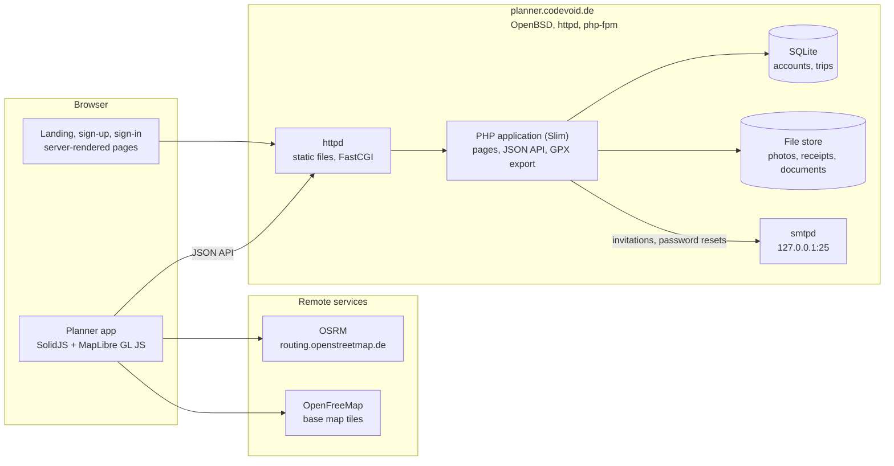
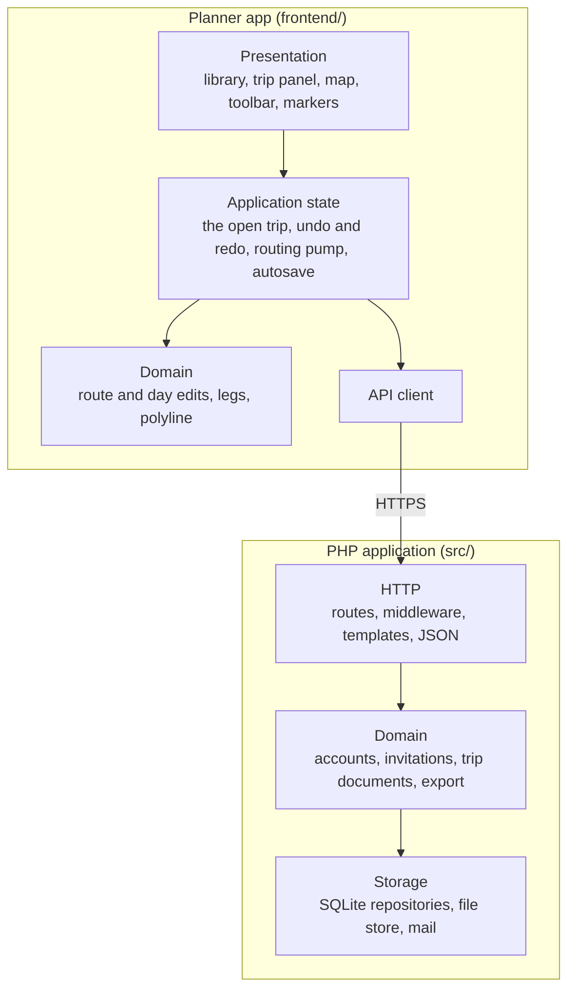
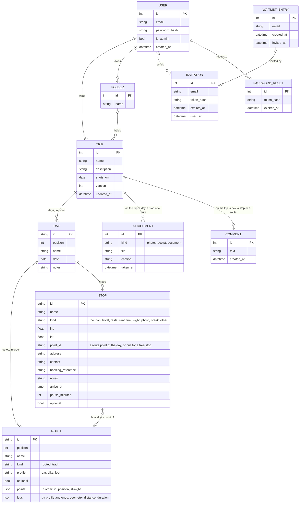

# Architecture

## High-level architecture

The server renders the public pages and serves the planner app, which talks to it over a
JSON API. Routing and map tiles are fetched by the browser directly.

## Block diagram

| Layer | Contents |
|---|---|
| Presentation (frontend) | The library (`library/`), the trip panel (`trip/`), the map with its route lines, stop and point markers, interactions, toolbar, hint bar and context menu (`map/`), dialogs and small controls (`ui/`). |
| Application state (frontend) | The open trip with undo and redo and the actions that edit it (`state/trip.ts`), the pull-based routing pump (`state/routing.ts`), the autosave (`state/autosave.ts`), the tool and the open menu (`state/drawing.ts`). |
| Domain (frontend) | Pure edits of a route and of a day's stops and routes, leg keys and geometry, the polyline codec, the OSRM client (`routing/`); distances and nearest-line search (`geo/`); the document types (`model/`). |
| API client (frontend) | `api.ts`: requests to the JSON API, the one place that knows its URLs. |
| HTTP (backend) | Slim routes and middleware (sessions, CSRF, body parsing, authentication), Plates templates for the public pages, JSON encoding of API answers (`Http/`, `Pages/`, `Api/`). |
| Domain (backend) | Accounts and password resets (`Account/`), waiting list and invitations (`Signup/`), trips and trip documents with their validator (`Trip/`), GPX writing (`Export/`). |
| Storage (backend) | PDO repositories over SQLite, the file store on disk, mail over SMTP (`Mail/`). |

## API

All under `/api`, for a signed-in user; answers are JSON unless a download.

| Method and path | Does |
|---|---|
| `GET /me` | The user's e-mail address and admin flag. |
| `GET /trips` | The user's trips, last changed first, with their day count. |
| `POST /trips` | Creates a trip from `{name}`. |
| `GET /trips/{id}` | The trip document: name, description, start date, version, places, days with stops and routes. |
| `PUT /trips/{id}` | Replaces the trip's content with the document sent, which carries the version it was loaded at; 409 when that is no longer the current version, 422 when the document is malformed or names parts of another trip. |
| `DELETE /trips/{id}` | Deletes the trip with everything in it. |
| `GET /trips/{id}/gpx` | The trip as GPX; `?day=<id>` one day; `?per=day` a zip with one file per day. |

## Database

The model as phase 2 builds it; the phase 1 schema in `db/schema.sql` still has stops in
a sequence with a route per gap and places apart from stops.

Attachments and comments are planned (phase 5). A trip's parts carry ids the client
generates, so that the trip's content is saved as one document: rows are upserted by id
and the ones the document no longer holds are deleted. A route's points and legs are
stored as JSON in the route's row, in the shape the editor works with; each routed leg
holds its polyline6 geometry, length and riding time as OSRM answered. A bound stop's
position equals its route point's, which the validator checks. Attachments and comments
will carry one nullable foreign key per possible target with a check that exactly one is
set, so that deleting a target deletes them.
