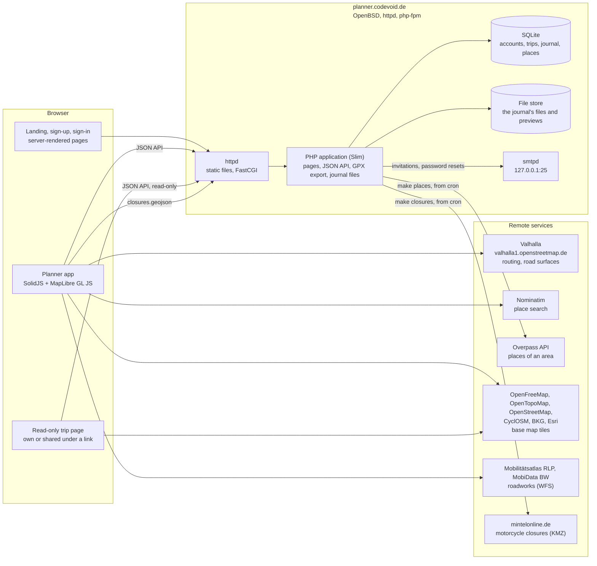
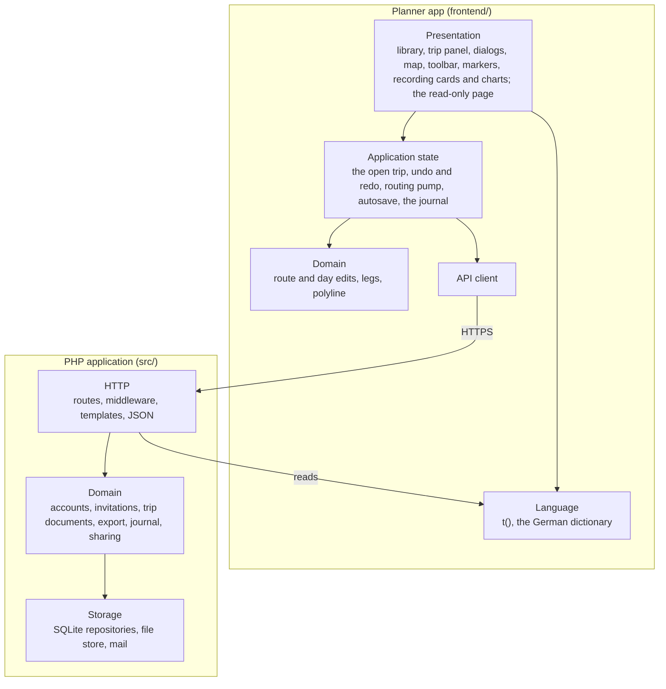
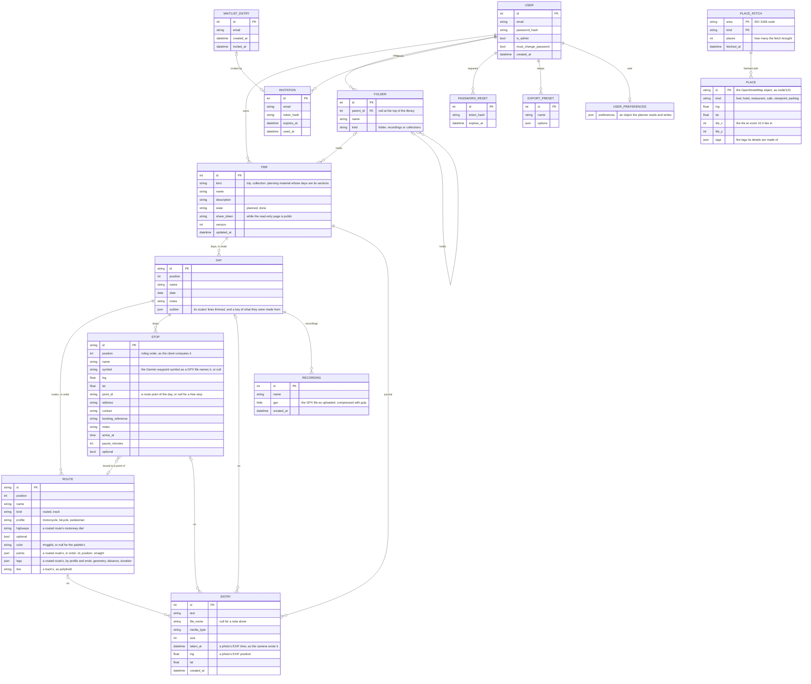

# Architecture

## High-level architecture

The server renders the public pages and serves the planner app, which talks to it over a
JSON API. Routing and map tiles are fetched by the browser directly.

## Block diagram

| Layer | Contents |
|---|---|
| Presentation (frontend) | The library's pane (its actions, search and the open trip's heading), the tree of folders and trips with their dragging onto folders, the duplicates report in the pane beside it, the import of what is dropped on a folder or picked from its menu, the zip reader and the import of exported trips (`library/`), the trip panel, the collection panel, the pane of the day picked, the days in the folded library's strip and their dialogs for the trip, a day, a route and a stop, the export, the journal and sharing (`trip/`), the preferences dialog (`preferences/`), the map with its base maps, its overlays (the roadworks, the motorcycle closures, the sizes and signs they draw with) and their controls, the place search, the places of the store with their control, route lines, stop, point and photo markers, interactions, toolbar and the routing's state, the opened recording's cards of figures and charts and the details of a point picked on it (`map/`), small controls, the chart, the dialog shell, the list that keeps its rows by id, the pane between the library and the map with its sheet handle, the one menu and the button that opens a row's, the keys of the file verbs, the long press and the pointer drags shared by the map and the panel, the lightbox, the theme, the colour tokens and the browser's preferences (`ui/`), and the read-only trip page with its own map (`view/`), a second entry (`view.tsx`). |
| Application state (frontend) | The open trip as an immutable value, the selected day and the route being edited, undo and redo and the actions that edit the trip (`state/trip.ts`), the pull-based routing pump (`state/routing.ts`), the autosave, which sends the stops in riding order (`state/autosave.ts`), the open trip's journal (`state/journal.ts`), the open trip's recordings, which days show them and their tracks once read (`state/recordings.ts`), the recording opened for its figures with its line's colouring, what it is compared with, the point picked on it and the surfaces under it once matched (`state/recordingView.ts`), what was copied or cut to be pasted into a day, a route, a trip or a folder (`state/clipboard.ts`), the days, routes or stops selected to be acted on together (`state/partSelection.ts`), the places on the map: the kinds switched on, the tiles read and the filter along the day's routes (`state/places.ts`), the account's preferences (`state/preferences.ts`), the library's trips and folders, the folder shown, the trip being opened and how far that has come, the search and whether the duplicates report is shown (`state/library.ts`), the duplicates report as last made and the lines of the routes selected in it (`state/duplicates.ts`), the tool, the toggles, which routes are unfolded, the open menu and dialogs (`state/drawing.ts`), whether the library is folded away and how much of a phone's screen the day's sheet takes (`state/panel.ts`). The colour of each route of the open trip (`state/routeColors.ts`). |
| Domain (frontend) | Pure edits of a route and of a day's stops and routes, the riding sequence of a day with distances and riding times, the day's timeline, leg keys and geometry, the polyline codec, the Valhalla client for routing and for the surfaces under a track (`routing/`); the palette of route colours and how routes without one of their own get theirs (`model/routeLook.ts`); reading GPX files into routes and stops (`gpx/`); reading and writing a recording's track with what it measured per point, its measures, summary and spreads, its comparison with another line by place, the colours of its line and the surfaces under it (`recording/`); the kinds of places, the tiles they are asked for by, the filter along lines and what a place's tags say (`poi/`); our icons, each standing for one Garmin symbol, and Garmin's symbols by theme (`symbols/`); distances, nearest-line search and line simplification (`geo/`); the document types and what of a document a save leaves out as unchanged (`model/`). |
| API client (frontend) | `api.ts`: requests to the JSON API, the one place that knows its URLs; every request names the page's language. |
| Language (both) | `frontend/i18n/`: the page's language, from the browser or the kept choice, `t()` with plurals, and the German dictionary `de.json` by English text, which the server's `t()` reads too (`src/I18n/`); a middleware sets the request's language from a `lang` query parameter or `Accept-Language`, `Json::error` translates the API's messages, the templates their texts. |
| HTTP (backend) | Slim routes and middleware (sessions, CSRF, body parsing, authentication, the request's language, gzip for JSON answers, which then carry their unpacked length as `X-Uncompressed-Length`), Plates templates for the public pages and the two bundle pages, JSON encoding of API answers (`Http/`, `Pages/`, `Api/`). |
| Domain (backend) | Accounts and password resets (`Account/`), waiting list and invitations (`Signup/`), the library's trips and folders with their state and share token, trip documents with their validator and copies, the outline kept with each day (`Trip/`), GPX writing with its options, the proximity of free stops, the export presets and the zip of whole trips (`Export/`), the journal's entries, EXIF reading, files and previews (`Journal/`), the recordings on the days (`Recording/`), the places of the map: the kinds, the question to the Overpass API and its answer, the fetch of an area and the store by tile (`Poi/`), the account's preferences (`Account/`), the read-only API of a shared trip (`Share/`), fetching Garmin's symbol pictures for `make garmin-icons` (`Symbols/`), fetching the motorcycle closures and converting their KML to GeoJSON for `make closures` (`Closures/`). |
| Storage (backend) | PDO repositories over SQLite, the file store on disk (`Journal/FileStore`), mail over SMTP (`Mail/`). |

## API

All under `/api`, for a signed-in user; answers are JSON unless a download or a file.

| Method and path | Does |
|---|---|
| `GET /me` | The user's e-mail address and admin flag. |
| `GET /preferences` | What the user set for the planner as a whole: an object the planner owns, empty until set. |
| `PUT /preferences` | Replaces the preferences with the object sent. |
| `GET /places/{x}/{y}` | The places in a tile of the web's maps at zoom 10 whose kind is among `kinds=` (comma-separated): id, kind, position and tags. Cacheable for a day. |
| `GET /trips` | The user's trips and collections, last changed first, with their kind, folder, state, day count and first dated day. |
| `POST /trips` | Creates a trip from `{name, folderId, kind}`; the folder may be null, the kind is `trip` (the default) or `collection`. A collection goes into a special folder or a folder in one, a trip anywhere else; 422 otherwise. |
| `GET /trips/{id}` | The trip document: kind, name, description, state, version, days (each with its date) with routes and stops in riding order. |
| `PUT /trips/{id}` | Replaces the trip's content with the document sent, which carries the version it was loaded at. A day, or a route of a day sent whole, may be sent as `{id, unchanged: true}` and then stands for the stored one. 409 when the version is no longer the current one, 422 when the document is malformed, names parts of another trip or leaves out as unchanged what the trip does not hold. |
| `POST /trips/{id}/copies` | A copy of the trip with all its days under new ids, named after it, in its folder; answers the copy's id. |
| `POST /trips/{id}/merge` | Merges the trips `{tripIds}` of the same kind into the trip and deletes them: a day joins the trip's day of its date or goes in among its days by date, an undated day or a section goes at the end; parts, journal entries and files keep their ids. Answers `{version}`. |
| `PATCH /trips/{id}` | Renames the trip to `{name}`, counted as a change to it; or puts it into the folder of `{folderId}`, or into none for null; 422 for a folder that does not hold its kind. |
| `DELETE /trips/{id}` | Deletes the trip with everything in it. |
| `GET /trips/{id}/gpx` | The trip as GPX with the options `per=trip|day` (one file, or a zip with one per day), `form=tracks|routes`, `optional=0|1`, `reachM=<metres>`. `days=<ids>` takes those days alone and `routes=<ids>` those routes alone, ids separated by commas; what then lies in one day is that day's file. 404 when none of them is in the trip. |
| `GET /trips/archive` | The trips named by `ids=` (comma-separated) as a zip to keep or to import again: a folder per trip with `trip.json` (document, journal, recordings), the journal's files, the recordings as GPX and a GPX file per day. Trips of another user are left out; 404 when none is left. |
| `GET /trips/outlines` | The outlines of the user's trips by trip id: its days in order, each with its id, name and date, how many routes and stops it holds, its length in metres (`distanceM`) and the lines of its routes, thinned to a few points each, as polyline6 with the colour a route has of its own. |
| `GET /trips/{id}/share` | `{token}`: the token the trip's read-only page is public under, or null. |
| `POST /trips/{id}/share` | Makes the page public under the trip's token, a new one where it has none; answers `{token}`. |
| `DELETE /trips/{id}/share` | Takes the page off the public. |
| `GET /trips/{id}/entries` | The trip's journal entries, oldest first: text, file (name, media type, size, whether an image), the part it is on, when and where a photo was taken. |
| `POST /trips/{id}/entries` | Adds an entry from a multipart form: `text`, one of `dayId`, `stopId`, `routeId` (none for the trip), `file`. An import hands on `createdAt`, the time the entry was written. A photo's EXIF time and position are read; one with a time and no part goes to the day of that date. |
| `PATCH /trips/{id}/entries/{entry}` | Replaces the entry's text from `{text}`. |
| `DELETE /trips/{id}/entries/{entry}` | Deletes the entry with its file. |
| `GET /trips/{id}/entries/{entry}/file` | The file as uploaded, shown in the browser where it can be, offered for download otherwise. |
| `GET /trips/{id}/entries/{entry}/preview` | A small JPEG of an image entry. |
| `GET /trips/{id}/recordings` | The trip's recordings in the order they were added: id, day, name. |
| `POST /trips/{id}/recordings` | Adds a recording to a day from a multipart form: `dayId`, `name`, and `file`, a GPX file compressed with gzip. |
| `PATCH /trips/{id}/recordings/{recording}` | Renames the recording from `{name}`, or puts it on another day of the trip from `{dayId}`. |
| `DELETE /trips/{id}/recordings/{recording}` | Deletes the recording. |
| `GET /trips/{id}/recordings/{recording}/gpx` | The recording's GPX file, sent compressed (`Content-Encoding: gzip`). |
| `GET /export-presets` | The user's export presets by name. |
| `POST /export-presets` | Keeps `{name, options}` as a preset, replacing one of that name. |
| `DELETE /export-presets/{id}` | Deletes the preset. |
| `GET /duplicates` | The routes the user's library keeps more than once, in groups of exact copies or of the same ride, each route with its trip, day, name and length. |
| `GET /duplicates/lines` | The lines of the user's routes named by `routes=` (comma-separated ids), as polyline6 by the route's id, for the report to draw the routes selected in it. |
| `GET /folders` | The user's folders, each with the folder it is in (`parentId`, null at the top) and its `kind`: the two special ones first (`recordings`, `collections`), the others (`folder`) by name. |
| `POST /folders` | Creates a folder from `{name, parentId}`; the parent may be null. |
| `PATCH /folders/{id}` | Renames the folder from `{name}`, or moves it into the folder `{parentId}` (null for the top); a folder never goes into itself or a folder inside it, and one that holds collections never leaves the special folders, one that holds trips never enters them. A special folder is not found. |
| `DELETE /folders/{id}` | Deletes the folder; its trips and folders move up into the folder it was in, or to the top. With `?contents=delete` they are deleted with it instead, at any depth, the trips' journal files included. |

A trip shared under a token is readable without sign-in under `/api/shared/{token}`:
the document, `/entries`, `/entries/{entry}/file` and `/entries/{entry}/preview`, as above.

The read-only page is served at `/trips/{id}` for the owner and at `/t/{token}` for
everyone; the page names the API it reads from.

## Database

The schema is `db/schema.sql`.

A trip's parts carry ids the client generates, so that the trip's content is saved as
one document: rows are upserted by id and the ones the document no longer holds are
deleted; the rows of a day or a route the document sends as unchanged are left as they
are. A route's points and legs are stored as JSON in the route's row, in the shape
the editor works with; each routed leg holds its polyline6 geometry, length and riding
time as the routing answered. A bound stop's position equals its route point's, which the
validator checks. A journal entry belongs to its trip and names at most one of a day, a
stop or a route by a nullable foreign key, which the schema checks; when that part goes,
the key is set to null and the entry stays with the trip. An entry's file lies in the
file store under `files/{trip}/{entry}`, its preview beside it.
