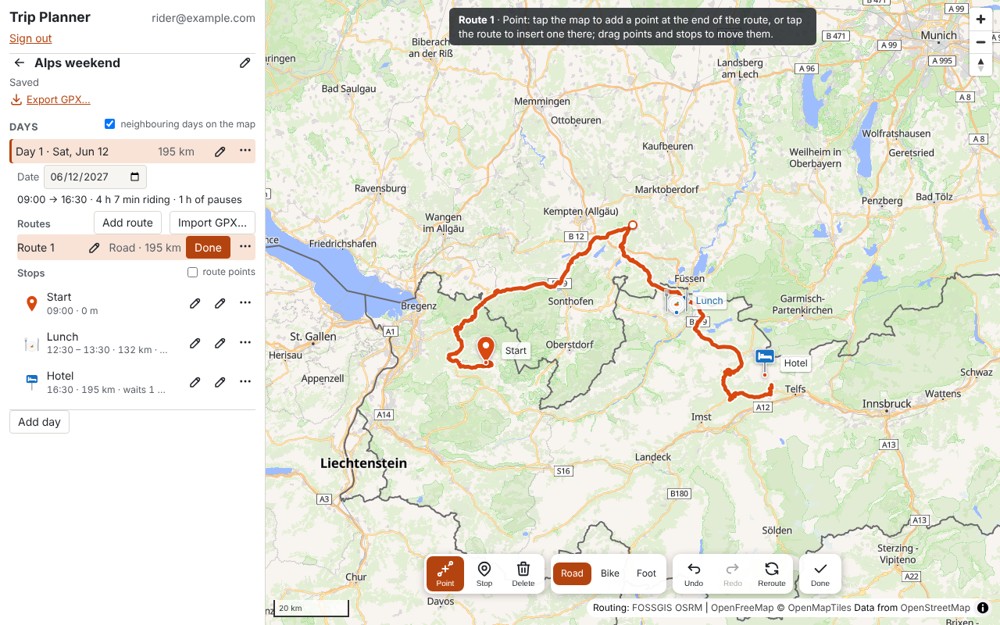

Plans whole motorcycle trips, not single routes: days of routes drawn along the roads,
stops on them or beside them, exported as GPX in the shape a device needs.

Runs at <https://planner.codevoid.de>, by invitation. In development: planning a trip on
the map with its times and exporting it works; GPX import, photos and receipts are on
the way.

## Features

- **Trips of days** — a trip is a sequence of days; a day has one or more routes and the
  stops of the day.
- **Routes drawn on the map** — tap to add points, tap the route to insert one, drag
  points and stops, delete them; straight legs where the routing knows no way. Routed
  along the roads by OSRM with a road, bike or foot profile per route; undo and redo.
- **Stops bound or free** — a route point becomes a stop with one tap; a stop beside the
  route is placed freely, listed where the rider passes closest, connected to the route
  when wanted. Hotel, restaurant, café, fuel, sight, photo spot or break, each drawn as
  what it is, with address, contact, booking reference and notes.
- **The day at a glance** — the panel lists a day's routes and its stops in riding order
  with the distance from the start; a click shows the stop on the map. The days before
  and after are drawn dimmed for orientation.
- **Times that add up** — give the first stop a time, others a fixed arrival time or a
  pause: the plan shows when it gets where, where it waits, and where the ride falls
  short of a fixed time.
- **Saved as you go** — every change is saved to your account moments later.
- **Rearranged as plans change** — days and routes move up and down or get duplicated,
  a route moves to another day, a stop is copied to one, a whole trip is duplicated.
- **A library with folders** — trips sorted into folders, and a search across them.
- **GPX in as well as out** — a file from the device or BaseCamp drops into a day: its
  routes, tracks and waypoints become routes and stops.
- **GPX export the way the device wants it** — the trip or a day, one file or one per
  day, routes as tracks or as points for the device to route, with or without the
  optional parts; the settings kept as named presets.

## Getting started

1. Join the waiting list on the landing page; the invitation comes by mail.
2. Sign in, name a new trip, add a day, add a route.
3. Tap the map for the route's points; the road between them is routed. Pick the *Stop*
   tool and tap a point to make it a stop, or tap beside the route for a free stop.
   *Done* ends editing.
4. Open a stop's details for its arrival time and pause; the first stop's time starts
   the day's timeline.
5. *Export GPX…* in the trip's panel: pick the scope and the form, download.

| Key or gesture | Does |
|---|---|
| Ctrl+Z, Ctrl+Shift+Z | Undo, redo |
| Esc | Closes a menu; back to the Point tool; ends editing |
| Right-click or long press on a stop or point | Make a stop, connect, disconnect, straight leg, remove |
| Right-click or long press on the map | Add a point or a free stop here |
