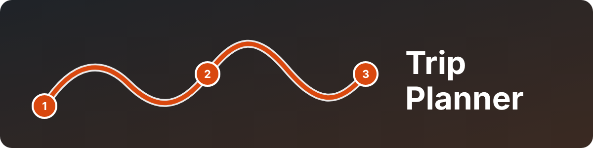
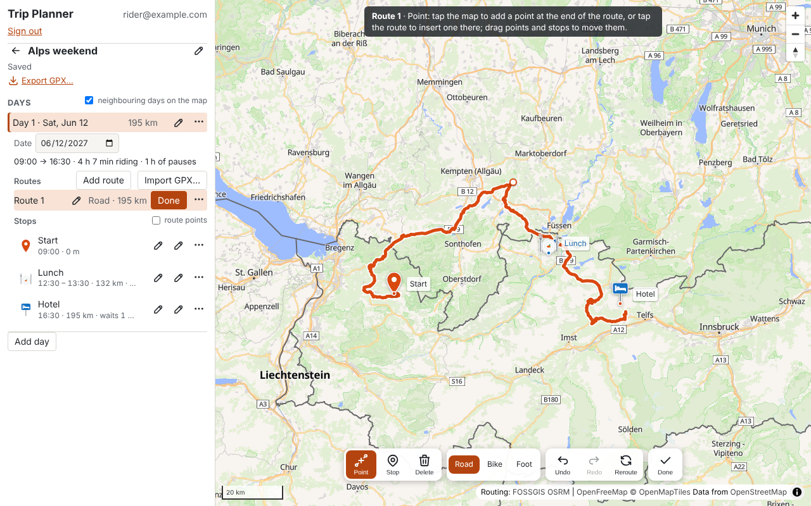

Plans whole motorcycle trips, not single routes: days of routes drawn along the roads,
stops on them or beside them, exported as GPX in the shape a device needs.

Runs at <https://planner.codevoid.de>; sign up with your e-mail address. In development: planning a trip on
the map with its times, GPX in and out, a journal with photos, and a page to print or
share work; sharing between users is on the way.

## Features

- **Trips of days** — a trip is a sequence of days; a day has one or more routes and the
  stops of the day.
- **Routes drawn on the map** — tap to add points, tap the route to insert one, drag
  points and stops, delete them; straight legs where the routing knows no way. Routed
  along the roads by Valhalla as a motorcycle, a bicycle or on foot, with a motorway dial
  for the transfer days; undo and redo.
- **Stops bound or free** — a route point becomes a stop with one tap; a stop beside the
  route is placed freely, listed where the rider passes closest within 500 m, connected
  to the route when wanted. Each stop keeps its Garmin symbol: twelve are drawn as our
  own icons, every other one as Garmin's picture. Address, contact, booking reference and
  notes go with it.
- **The day at a glance** — the panel lists a day's routes and its stops in riding order
  with the distance from the start; a click shows the stop on the map. The days before
  and after are drawn dimmed for orientation.
- **Times that add up** — give the first stop a time, others a fixed arrival time or a
  pause: the plan shows when it gets where, and right before a stop whether the ride is
  late or early for its time.
- **Saved as you go** — every change is saved to your account moments later.
- **Rearranged as plans change** — days and routes are dragged into place or duplicated,
  a route moves to another day, routes and stops are copied and pasted into any day of any
  trip, a whole trip is duplicated, trips imported one file each are merged into one.
- **A library with folders** — trips sorted into folders inside folders, dragged by their
  pad from one to another, and a search across them. GPX files and folders are added
  from a folder's menu or dropped on it: a folder of files becomes a trip, a folder of
  folders a folder of trips.
- **Four tabs** — Stash for planning material to copy routes from, Trips, Places for
  lists of your own places, and Recordings. Each keeps what you unfolded and selected
  while you look at another.
- **One way back** — the card under the path leads one level up, from a day to its trip
  to its folder to the top, and never moves.
- **Duplicates found** — a report lists the routes kept more than once across the
  library, copies and the same ride from two apps; select some to copy or delete them.
- **Planning material** — a trail or a tour collection, such as the TET by country, kept
  as a collection to browse on the map and copy routes from into your own days.
- **GPX in as well as out** — a file from the device or BaseCamp drops into a day: its
  routes, tracks and waypoints become routes and stops. KML and KMZ files are read too. A recorded track keeps every
  point; condense it or turn it into a route from its menu.
- **GPX export the way the device wants it** — the trip or a day, one file or one per
  day, routes as tracks or as points for the device to route, with or without the
  optional parts; the settings kept as named presets.
- **Trips to keep or to move** — export one or several as a zip with journal, photos and
  recordings; import the zip, or its unpacked folder, to get them back.
- **Recordings beside the plan** — put rides as recorded (Ridelink, Scenic or any GPX
  track) on a day, or look up the ones that match it, and see them on the map next to
  the planned route. A ride can be on several days; a day can take several rides. One
  run suggests days for the rides that have none, to accept or decline. Open one for its figures: speed, climb, lean and road
  surface, charted and coloured on the line.
  Compare it with the plan or another ride.
- **Documents with the day** — keep PDFs, pictures, any other file and links with a
  day; a folder's documents come along when it is imported.
- **A journal on everything** — notes, photos, receipts and documents on the trip, a
  day, a stop, a route, or a spot on the map. Photos shrink to a web size before they
  leave the phone, stand on the map where they were taken, land on the day they were
  taken and open large in place.
- **Planned, then ridden** — mark a trip done; the library shows it.
- **Print it, share it** — a read-only page with the map, every day's stops and times
  and the journal, for printing, or shared under a link that needs no account.
- **Roadworks and closures** — a button each on the map shows the roadworks of
  Rhineland-Palatinate and Baden-Württemberg and the roads closed to motorcycles; tap one
  for what and until when.
- **Where you have been** — a third button draws every recorded ride at once: the roads
  you ride often dark, the ones you never took not at all. It stays on while planning.
- **Rides by date** — every recording in years, months and days of riding, kept once
  whatever plans it followed; drop your tracker's files there, select some and compare
  them on the map. Name them after where they began and ended, and merge the pieces
  of one outing.
- **Fuel, beds and food** — fuel stations, hotels, restaurants, cafes, viewpoints and
  parking as a layer: along the day's routes, each kind within its own distance, or all
  in view.
- **Find the place** — search a town, a pass or an address; the map flies there and pins
  it, ready to become a point or a stop.
- **Your map, your colours** — OpenFreeMap styles, OpenTopoMap, OpenStreetMap,
  CyclOSM or TopPlusOpen tiles, or satellite imagery under the routes; the interface light or dark by hand.
- **English or German** — the planner, its pages and mails follow the browser's language,
  or the one picked in the preferences; the GPX export names its days along.

## Getting started

1. Enter your e-mail address on the landing page; the link to set your password comes
   by mail.
2. Sign in, name a new trip with the map icon on top, add a day and a route with the
   plus on their headers.
3. Pick the *Point* tool and tap the map for the route's points; the road between them
   is routed. Pick the *Stop* tool and tap a point to make it a stop, or tap beside the
   route for a free stop. *Done* or Esc leaves the route; a click on a route's row
   selects it again, with its stops listed under it.
4. Open a stop's details for its arrival time and pause; the first stop's time starts
   the day's timeline.
5. The download icon on the trip's path heading exports GPX: pick the scope and the
   form, download.
6. After the ride, the journal icon on a day, a stop or a route takes the notes and
   photos, *Journal here…* in the map's menu puts one at a spot, and the trip's journal
   icon reads it all top down; its share icon opens the trip's page or shares it under a
   link.

| Key or gesture | Does |
|---|---|
| Ctrl+Z, Ctrl+Shift+Z | Undo, redo |
| Ctrl+X, Ctrl+C, Ctrl+V, Delete | Cut, copy, paste and delete what is selected, in the trip and in the library |
| Esc | Closes a menu; back to the Hand; leaves the route |
| Space, held | The Hand while a drawing tool is picked |
| Click or tap a route on the map | Shows its day and takes the route up |
| The pin on a route or a recording | Keeps it on the map while another is taken up |
| Right-click or long press on a stop or point on the map | Convert to stop, connect, disconnect, straight leg, remove |
| Right-click or long press on the map | Add a point or a free stop here, a journal entry, or open the spot in Google Maps, OpenStreetMap or Street View |
| Right-click, long press or the three dots on a folder, trip, day, route or stop in the panel | Its menu: new, add, rename or edit, move, copy or paste, duplicate, delete |
| Tap or click the grip pad of a trip or a duplicate; Cmd/Ctrl-click, Shift-click | Select several; their menu moves, deletes or merges trips, or copies or deletes duplicates |
| Drag a trip's or a folder's pad onto a folder or the card one level up | Move it, or the selected trips, there |
| Drop GPX files or folders from the computer on a folder | Import them into it |
| Enter in the search box | Find a place; Esc closes the list |
| Drag the panel's edge | Set the panel's width; double-click for the default |
| Drag a day's or a route's grip | Put it in another place; the arrow keys on the grip move it one place |
